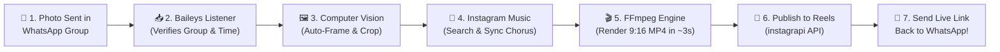

# 🎬 WhatsApp to Instagram Reels Automation Engine

<p align="center">
  
  
  
  
  
  
  
  
</p>

<p align="center">
  An autonomous, production-ready pipeline that listens to designated <b>WhatsApp Groups</b> for incoming photos, automatically crops and composites each image into a <b>custom brand frame</b>, attaches synchronized audio from <b>Instagram's official music catalog</b>, renders a vertical <b>9:16 Instagram Reel</b> in ~3 seconds, auto-publishes it to <b>Instagram Reels</b> with dynamic captions & hashtags, and shares the live Reel link back to the WhatsApp community.
</p>

---

## 📑 Table of Contents

- [Overview & Use Cases](#-overview--use-cases)
- [How It Works (Visual Flow)](#-how-it-works-visual-flow)
- [Key Features](#-key-features)
- [Technology Stack](#-technology-stack)
- [Project Structure](#-project-structure)
- [Quick Start Guide](#-quick-start-guide)
  - [1. Prerequisites](#1-prerequisites)
  - [2. Installation](#2-installation)
  - [3. Configure Environment Variables](#3-configure-environment-variables)
  - [4. Connect WhatsApp](#4-connect-whatsapp)
  - [5. Connect Instagram](#5-connect-instagram)
  - [6. Test Locally](#6-test-locally)
  - [7. Start the Service](#7-start-the-service)
- [Customization Guide](#-customization-guide)
  - [Custom Brand Frame / Template](#1-custom-brand-frame--template)
  - [Background Music & Audio Strategy](#2-background-music--audio-strategy)
  - [Dynamic Captions & Hashtags](#3-dynamic-captions--hashtags)
  - [Time Windows & Multi-Group Filtering](#4-time-windows--multi-group-filtering)
- [Cloud Deployment (Render / Docker / Railway)](#-cloud-deployment-render--docker--railway)
- [CLI Commands Reference](#-cli-commands-reference)
- [Anti-Ban & Safety Architecture](#-anti-ban--safety-architecture)
- [Frequently Asked Questions (FAQ)](#-frequently-asked-questions-faq)
- [License & Disclaimer](#-license--disclaimer)

---

## 💡 Overview & Use Cases

Creating vertical video content every day is time-consuming. Whether managing a community page, an e-commerce storefront, or a cultural organization, taking a raw photo and converting it into a branded Reel with trending music typically requires opening video editing software, rendering, exporting, and manually uploading.

**This engine completely automates the workflow end-to-end:**
1. A team member or admin drops a photo into a WhatsApp group.
2. The bot detects, downloads, and auto-frames the photo onto your branded canvas.
3. The bot searches Instagram's music library for the day's song and syncs the chorus.
4. An HD 1080×1920 MP4 Reel is generated in ~3 seconds.
5. The Reel is posted to Instagram with custom hashtags and captions.
6. The bot sends a direct confirmation message with the live Reel link back to WhatsApp.

### 🌐 Universal Use Cases

| Industry / Niche | How It Is Used |
| :--- | :--- |
| 🏛️ **Temples, Churches & Cultural Centers** | Daily darshan, morning prayers, community announcements, and festival photo highlights published automatically every morning. |
| 🛍️ **Retail, Boutiques & E-Commerce** | Staff post new inventory or product photos in an internal group ➔ automatically transformed into branded promotional Reels with trending music. |
| 📸 **Content Creators & Photographers** | Drop raw daily snapshots into a personal WhatsApp group ➔ automatically formatted into vertical video shorts with audio stickers. |
| 🏢 **Sports Clubs, Gyms & Event Venues** | Workout of the day, daily leaderboard, event recaps, or special announcements posted effortlessly. |

---

## 🎬 How It Works (Visual Flow)



---

## ✨ Key Features

- **⚡ Zero-Cost WhatsApp Integration**: Built with `@whiskeysockets/baileys` v7. Connects via WhatsApp Web QR code or phone pairing code. Requires **no paid WhatsApp Business Cloud API**.
- **🎵 Official Instagram Audio Integration**: Uses `instagrapi` to search Instagram's official live music catalog, download the preview segment, seek to the chorus highlight timestamp, and link the official audio sticker directly to the Reel for higher organic reach.
- **🖼️ Smart Computer Vision Auto-Framing**: Pillow/NumPy engine automatically detects image subjects, centers idols/products, applies rounded corners and elevation drop shadows, and fits the image seamlessly into your brand frame (`assets/template.png`).
- **🎬 Ultra-Fast, Low-Memory Video Synthesis**: Optimized FFmpeg engine with `-tune stillimage` and `-preset ultrafast`. Generates 1080×1920 30FPS MP4 videos with audio fade-out in **under 3 seconds** while using **<25 MB of RAM**.
- **☁️ Cloud-Native & 512 MB RAM Friendly**: Engineered specifically to run 24/7 on free/low-spec cloud instances (e.g., Render, Railway, Docker) without memory crashes or disk requirements.
- **🔄 Zero-Maintenance Session Persistence**: Includes `WA_SESSION_DATA` and `IG_SESSION_DATA` environment variable restoration, keeping your WhatsApp and Instagram connections alive across all container restarts and rebuilds without persistent disks.
- **🛡️ Concurrency & Anti-Spam Queue**: FIFO sequential job queue with an automatic 20-second safety cooldown prevents CPU spikes and protects your Instagram account from spam or rate-limit penalties.
- **📲 Full Feedback Loop**: After publishing, automatically posts a formatted notification message with the clickable Instagram Reel URL back into the WhatsApp group.

---

## 🛠️ Technology Stack

| Domain | Technology / Library | Role |
| :--- | :--- | :--- |
| **Orchestrator** | Node.js (v18+) & TypeScript | Main daemon, group listeners, task scheduling, health ping server. |
| **WhatsApp Client** | `@whiskeysockets/baileys` (v7) | WebSocket connection, protobuf media decryption, message streaming. |
| **Video Engine** | `fluent-ffmpeg`, `ffmpeg-static` | 9:16 canvas scaling, audio looping, highlight offset seeking, AAC encoding. |
| **Image Framer** | `Pillow` (PIL) & `NumPy` (Python) | Subject centering, rounded corners, soft drop shadow, template overlay. |
| **Instagram Publisher** | `instagrapi` (Python) | Mobile API emulation, music catalog search, Reels upload with audio stickers. |
| **Session Persistence**| Node.js `zlib` + Base64 | Compact environment variable session encoding (`WA_SESSION_DATA`). |
| **Containerization** | Docker, Docker Compose | Production deployment ready for Linux/cloud platforms. |

---

## 📁 Project Structure

```
├── assets/
│   ├── template.png          # 🖼️ Full-resolution brand template (logo, frame, overlays)
│   ├── template_1080.png     # ⚡ Pre-scaled 1080x1920 template for ultra-fast rendering
│   ├── music/                # 🎵 Optional local MP3 tracks (fallback if catalog search fails)
│   └── session.tar.gz        # 📦 Bundled session backup archive
├── config/
│   ├── env.ts                # ⚙️ Typed environment settings & defaults
│   ├── captions.ts           # ✍️ Caption generator (dates, custom text, hashtags, calendars)
│   └── music.ts              # 🎶 Music search queries (day-wise schedule or static topics)
├── scripts/
│   ├── scan-wa-qr.ts         # 📱 Scan WhatsApp QR & discover group IDs
│   ├── pack-session.ts       # 🔑 Export persistent WA_SESSION_DATA for cloud hosting
│   ├── search-insta-music.ts # 🔍 Test Instagram music catalog search
│   ├── test-video.ts         # 🎬 Test local 9:16 Reel generation
│   ├── test-pipeline.ts      # 🧪 End-to-end dry-run pipeline test
│   └── post-last-image.ts    # 🚀 Manually publish the latest group image
├── src/
│   ├── index.ts              # 🚀 Main entry point & HTTP /ping health server
│   ├── instagram/
│   │   ├── ig_bridge.py      # Python instagrapi engine for music search & upload
│   │   └── uploader.ts       # TypeScript wrapper for Instagram operations
│   ├── video/
│   │   ├── image_framer.py   # Pillow image composition and auto-centering
│   │   ├── imageFramer.ts    # TypeScript wrapper for image_framer.py
│   │   └── reelGenerator.ts  # FFmpeg video renderer with -tune stillimage
│   ├── whatsapp/
│   │   ├── client.ts         # WhatsApp client, event listener & socket lifecycle
│   │   └── mediaHelper.ts    # Media message validation & buffer downloader
│   └── utils/
│       ├── cleanup.ts        # Media file cleaner & directory manager
│       ├── logger.ts         # Formatted timestamp/console logger
│       ├── queue.ts          # Sequential task queue with 20s cooldown
│       └── sessionSync.ts    # Automated session restoration from environment variables
├── .env.example              # Configuration template
├── Dockerfile                # Production multi-stage Docker build
├── render.yaml               # Render Web Service deployment blueprint
├── package.json
└── requirements.txt          # Python dependencies
```

---

## 🚀 Quick Start Guide

### 1. Prerequisites
Ensure you have the following installed on your machine:
- **Node.js** (v18.0.0 or higher) - [Download](https://nodejs.org/)
- **Python** (v3.10 or higher) with `pip` - [Download](https://www.python.org/)
- **FFmpeg** (Included automatically via `ffmpeg-static`, but system FFmpeg is recommended for Linux/Docker).

---

### 2. Installation

```bash
# 1. Clone the repository
git clone https://github.com/your-username/whatsapp-instagram-reels-automation.git
cd whatsapp-instagram-reels-automation

# 2. Install Node.js dependencies
npm install

# 3. Install Python dependencies
pip install -r requirements.txt
```

---

### 3. Configure Environment Variables

Copy the template to create your `.env` file:

```bash
cp .env.example .env
```

Open `.env` in any editor and set your credentials:

```env
# ----------------- WhatsApp Configuration -----------------
# Target WhatsApp Group JID (run "npm run wa:groups" to discover)
TARGET_WHATSAPP_GROUP_JID=1203630XXXXXXXXX@g.us

# Optional: Phone number for 8-digit pairing code (leave empty to use QR code)
WA_PAIRING_PHONE_NUMBER=

# ----------------- Instagram Configuration ----------------
INSTAGRAM_USERNAME=your_instagram_username
INSTAGRAM_PASSWORD=your_instagram_password

# ----------------- Reel Video Settings --------------------
REEL_DURATION_SECONDS=15
VIDEO_WIDTH=1080
VIDEO_HEIGHT=1920

# ----------------- Allowed Time Window (Optional) ---------
# Set the daily hours when photos should be processed (e.g. 6 AM to 12 PM)
DARSHAN_START_HOUR=6
DARSHAN_END_HOUR=12

# ----------------- Automation Flags -----------------------
# Set to 'true' to publish live to Instagram; 'false' for local generation only
ENABLE_AUTO_UPLOAD=true
DELETE_TEMP_AFTER_UPLOAD=true
```

---

### 4. Connect WhatsApp

Run the WhatsApp pairing utility:

```bash
npm run wa:scan
```

1. A **QR code** will appear in your terminal.
2. Open **WhatsApp** on your phone → Tap **Settings** (or three dots) → **Linked Devices** → **Link a Device**.
3. Scan the terminal QR code.
4. Discover your group IDs:
   ```bash
   npm run wa:groups
   ```
5. Copy your group's ID (e.g. `120363012345678901@g.us`) and paste it into `TARGET_WHATSAPP_GROUP_JID` in `.env`.

---

### 5. Connect Instagram

Authenticate your Instagram account once to generate your persistent session file (`ig_session.json`):

```bash
npm run ig:login
```
*(If your account has Two-Factor Authentication enabled, enter your 6-digit code in the terminal prompt).*

---

### 6. Test Locally

Run a test without uploading to verify that the video engine and framing operate properly:

```bash
npm run test:video
```
*Check `temp/videos/` on your computer to view the newly rendered 15-second vertical Reel with audio!*

---

### 7. Start the Service

```bash
# Production mode
npm start

# Development mode (with auto-reload on file edits)
npm run dev
```

Whenever a photo is shared in your configured WhatsApp group during allowed hours:
1. The photo is downloaded and framed with your brand template.
2. Background audio is retrieved and synchronized.
3. An HD 9:16 vertical Reel is rendered.
4. The Reel is published to Instagram Reels.
5. The live link is posted back to the WhatsApp group!

---

## 🎨 Customization Guide

### 1. Custom Brand Frame / Template
The template is stored in `assets/template.png`.
- You can replace this image with your own organization, store, or brand frame.
- **Recommended Canvas Size**: 1080×1920 (or 3375×6000).
- Keep the center area open for photos, and place your logo, social handles, or borders at the top and bottom.
- Run `npm run test:video` anytime to preview how your photos fit into the new template.

---

### 2. Background Music & Audio Strategy
Audio behavior is managed in [`config/music.ts`](config/music.ts). You can configure:
- **Day-by-Day Search**: Map specific queries to each day of the week (e.g., Monday: Acoustic, Friday: Upbeat Party, Sunday: Devotional).
- **Static Topic Search**: Use a single search term for all Reels.
- **Local Fallback MP3s**: Place your own `.mp3` or `.m4a` files into `assets/music/` to use as an offline fallback if Instagram music search is unavailable.

---

### 3. Dynamic Captions & Hashtags
Captions are managed in [`config/captions.ts`](config/captions.ts):
- Customize greeting lines, call-to-actions, and viral hashtags.
- Automatically appends today's date, day name, and any custom text originally sent as the photo's WhatsApp caption.
- Includes an optional astronomical Hindu Panchang calculator for temple communities that calculate daily Tithis.

---

### 4. Time Windows & Multi-Group Filtering
- **Time Gating**: Configure `DARSHAN_START_HOUR` (e.g., `6` for 6:00 AM) and `DARSHAN_END_HOUR` (e.g., `22` for 10:00 PM) in `.env` to ensure photos sent late at night are ignored.
- **Multiple Groups**: You can monitor multiple WhatsApp groups simultaneously by separating their IDs with commas in `.env`:
  ```env
  TARGET_WHATSAPP_GROUP_JID=120363011111111111@g.us,120363022222222222@g.us
  ```

---

## ☁️ Cloud Deployment (Render / Docker / Railway)

The project is fully containerized and designed to run 24/7 on free/low-spec cloud instances (e.g., [Render](https://render.com/)).

### 🔑 Making Sessions Permanent on Ephemeral Containers
On cloud platforms with ephemeral disks, containers reset on every reboot or deploy. This bot uses **Environment Variables** so you never have to scan QR codes again:

1. Connect WhatsApp and Instagram once on your computer.
2. Run the session exporter:
   ```bash
   npm run session:pack
   ```
3. The script will output two compact strings:
   - `WA_SESSION_DATA`
   - `IG_SESSION_DATA`
4. Add these two strings as **Environment Variables** in your cloud hosting dashboard (e.g., Render Dashboard ➔ Environment).
5. Whenever your container restarts or redeploys, it automatically restores the sessions directly from the environment variables!

### 🩺 Keeping Cloud Servers Awake 24/7
- The application includes an HTTP server that listens on port `3000` (or `$PORT`).
- It exposes a `/ping` health endpoint.
- Set up a free monitor on [UptimeRobot](https://uptimerobot.com/) to ping `https://your-service.onrender.com/ping` every 5 minutes to keep free cloud instances active 24/7.

---

## ⌨️ CLI Commands Reference

| Command | Description |
| :--- | :--- |
| `npm start` | Launches the production 24/7 automation service. |
| `npm run dev` | Runs the service in development mode with hot-reloading (`tsx watch`). |
| `npm run wa:scan` | Displays terminal QR code or pairing prompt to connect WhatsApp. |
| `npm run wa:groups` | Lists all participating WhatsApp groups and their unique JID strings. |
| `npm run ig:login` | Authenticates with Instagram and saves credentials to `ig_session.json`. |
| `npm run ig:music` | Tests Instagram's live music search for today's configured audio query. |
| `npm run test:video` | Generates a test 9:16 Reel locally in `temp/videos/` without uploading. |
| `npm run test:pipeline` | Runs an end-to-end dry-run test of all modules (framing, audio, video). |
| `npm run session:pack` | Exports `WA_SESSION_DATA` & `IG_SESSION_DATA` for cloud deployments. |
| `npm run post:last` | Manually downloads the latest image from the group and publishes it immediately. |
| `npm run build` | Compiles TypeScript into production JavaScript in `dist/`. |

---

## 🛡️ Anti-Ban & Safety Architecture

To ensure account longevity and avoid automated blocks:
1. **Device Fingerprint Persistence**: `ig_session.json` and `WA_SESSION_DATA` cache device parameters, preventing repetitive logins that trigger security checkpoints.
2. **Sequential FIFO Task Queue**: Enforces an automated **20-second cooldown** between consecutive uploads so your account is never flagged for rapid posting.
3. **Strict Group Quarantine**: Only processes messages from explicitly configured group IDs. Personal chats, status broadcasts, and external groups are completely ignored.
4. **Single Active Connection Guard**: Includes socket protection that detects if another client connects with the same session, preventing infinite reconnect loops that could revoke device authorization.

---

## ❓ Frequently Asked Questions (FAQ)

#### Q1: Does this require paid APIs?
**No.** All components (Node.js, Python, FFmpeg, Baileys, Instagrapi) are 100% free and open-source.

#### Q2: What happens if multiple photos are posted at once?
The built-in sequential task queue processes photos **one by one**, waiting 20 seconds between posts. This prevents CPU exhaustion and avoids Instagram rate limits.

#### Q3: Can I run this bot on my computer and the cloud at the same time?
**No.** WhatsApp strictly allows only **one active connection per session**. Running the bot on your computer and on a cloud server at the same time will cause a session conflict. Once deployed to the cloud, turn off your local instance.

#### Q4: How fast is video rendering?
Thanks to `-tune stillimage` and direct template compositing, each 15-second 1080×1920 MP4 video renders in **2 to 3 seconds** on standard hardware.

---

## 📜 License & Disclaimer

- Distributed under the **ISC License**.
- *Disclaimer*: This project is an independent automation tool and is not affiliated with, authorized, maintained, or endorsed by WhatsApp, Meta, or Instagram. Use responsibly and in accordance with each platform's Terms of Service.
