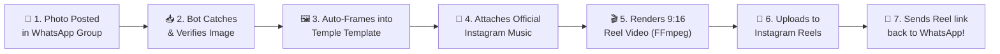

# 🌺 Shree MomaiDham: Automated WhatsApp to Instagram Reels Bot

<p align="center">
  
  
  
  
  
  
  
</p>

---

## 💡 What Does This System Do? (In Simple Words)

Every morning, temple devotees and priests post daily **Darshan (Pooja) photos** in a private WhatsApp group. 

Normally, an admin would have to manually download the photo, open a video editing app, add the temple border/frame, find a devotional song, render a vertical video, write the Gujarati tithi/caption, and post it to Instagram Reels.

**This bot does everything 100% automatically in under 60 seconds:**

```
1. 📸 Photo arrives in WhatsApp Group (Between 5:00 AM – 1:00 PM)
   ⬇️
2. 🤖 Bot downloads the photo automatically
   ⬇️
3. 🖼️ Centers the idol and places it inside the official temple frame
   ⬇️
4. 🎵 Finds and attaches today's official devotional song from Instagram
   ⬇️
5. 🎬 Generates a vertical 9:16 HD video (Reel) with smooth audio fade-out
   ⬇️
6. ✍️ Calculates today's Gujarati date & Hindu Tithi (e.g. કારતક સુદ છઠ)
   ⬇️
7. 🚀 Publishes the Reel directly to your Instagram account
   ⬇️
8. 📲 Replies back to the WhatsApp group with the direct link to the Reel!
```

---

## 🎬 Visual Workflow



---

## 🌟 Why is it Special?

- 🆓 **100% Free**: Uses open-source tools. No paid WhatsApp Cloud API fees and no paid video editing software subscriptions.
- 🎯 **Strictly Safe**: Only accepts photos from your specific WhatsApp group and only during morning darshan hours (5 AM - 1 PM). It completely ignores personal chats, other groups, or photos sent at night.
- 🎶 **Real Instagram Music**: Unlike basic bots that upload muted videos or royalty-free elevator music, this bot links **real devotional songs directly from Instagram's official music library** so your Reel gets higher organic reach.
- 🗓️ **Automatic Gujarati Panchang**: You never have to look up the Hindu calendar. The bot calculates the exact Gujarati Tithi (*સુદ / વદ*) automatically every morning.
- 🛡️ **Anti-Ban Protection**: Built-in 20-second cooldown between posts to make sure Instagram never flags your account for spam.

---

## 🛠️ How It Works (Technology Breakdown)

| Stage | What Happens | Which Technology Is Used? |
| :--- | :--- | :--- |
| **WhatsApp Connection** | Connects to your WhatsApp just like WhatsApp Web on your PC. Listens 24/7 for new messages. | **Node.js** + **Baileys** (`@whiskeysockets/baileys`) |
| **Safety Filters** | Checks: 1) Is it from the allowed group? 2) Is it an image? 3) Is it today's date? 4) Is it morning (5 AM - 1 PM)? | **TypeScript logic** |
| **Idol Detection & Framing** | Detects the red color of Mataji's canopy, cuts out side pillars, centers the deities, adds shadows, and places the photo inside the temple frame (`assets/template.png`). | **Python** + **Pillow (PIL)** + **NumPy** |
| **Music Catalog Search** | Searches Instagram's music library for today's song (e.g., Tuesday: *Dakla*, Wednesday: *Garba*, Friday: *Lakshmi Maa*) and finds the best chorus highlight. | **Python** + **instagrapi** |
| **Video Production** | Combines the framed image + background music into an HD vertical MP4 video (1080×1920) with a 1.5-second audio fade at the end. | **FFmpeg** (`fluent-ffmpeg`) |
| **Instagram Upload** | Logs in securely using saved session cookies, sets the thumbnail, Gujarati caption, hashtags, and publishes the Reel. | **Python** + **instagrapi** |
| **WhatsApp Notification** | Sends a confirmation message with the live Reel link back into the WhatsApp group. | **Baileys WhatsApp Client** |

---

## 📁 Project Directory (Where Files Live)

```
momaidham-automation/
├── assets/
│   ├── template.png          # 🖼️ The temple frame (logo at top, address at bottom)
│   └── music/                # 🎵 Backup MP3 songs (if internet search fails)
├── config/
│   ├── env.ts                # ⚙️ Settings (Group ID, account names, time windows)
│   ├── music.ts              # 🎶 Day-by-day song list (Monday, Tuesday, etc.)
│   └── captions.ts           # ✍️ Gujarati calendar calculator & hashtag list
├── src/
│   ├── index.ts              # 🚀 Main starter file (keeps the bot running 24/7)
│   ├── whatsapp/             # 📱 WhatsApp connection and image downloader
│   ├── video/                # 🎬 Video generator and image framing scripts
│   ├── instagram/            # 📸 Instagram login and Reel uploader
│   └── utils/                # ⏳ Anti-spam queue and temporary file cleanup
├── .env                      # 🔑 Secret passwords and configuration
├── package.json              # 📦 List of Node.js dependencies
└── requirements.txt          # 🐍 List of Python dependencies
```

---

## 🚀 Easy Setup Guide (Step-by-Step)

### Step 1: Install Requirements
Make sure your computer or server has:
1. **Node.js 18+** → [Download Node.js](https://nodejs.org/)
2. **Python 3.10+** → [Download Python](https://www.python.org/)

Then open your terminal or command prompt inside the project folder:

```bash
# 1. Install Node.js tools
npm install

# 2. Install Python tools
pip install -r requirements.txt
```

---

### Step 2: Configure Your Settings (`.env`)

Copy `.env.example` to create your `.env` file:

```bash
cp .env.example .env
```

Open `.env` in any text editor (like Notepad or VS Code) and set your details:

```env
# 1. Instagram login credentials
INSTAGRAM_USERNAME=your_instagram_username
INSTAGRAM_PASSWORD=your_instagram_password

# 2. Target WhatsApp Group (We will get this in Step 3)
TARGET_WHATSAPP_GROUP_JID=

# 3. Reel settings
REEL_DURATION_SECONDS=15
ENABLE_AUTO_UPLOAD=true

# 4. Morning allowed window (5 AM to 1 PM IST)
DARSHAN_START_HOUR=5
DARSHAN_END_HOUR=13
```

---

### Step 3: Connect WhatsApp

Run the WhatsApp connector:
```bash
npm run wa:scan
```
1. A **QR code** will appear directly in your terminal.
2. Open **WhatsApp** on your phone → Tap **Settings** (or 3 dots) → **Linked Devices** → **Link a Device**.
3. Scan the QR code with your phone.
4. Now, list all your groups to find your group's unique ID:
   ```bash
   npm run wa:groups
   ```
5. You will see an output like:
   ```text
   "Shree Momai Dham Darshan Group" -> ID: 120363012345678901@g.us
   ```
6. Copy that ID and paste it into `TARGET_WHATSAPP_GROUP_JID` inside your `.env` file!

---

### Step 4: Connect Instagram

Run this command once to log in and save your session safely:
```bash
npm run ig:login
```
*(If your Instagram has 2FA enabled, it will ask you to type the 6-digit SMS code right in the terminal. Your login is saved in `ig_session.json` so you never have to log in again!)*

---

### Step 5: Test Everything Locally (Safe Mode)

Before letting it run live, test if the video generation works on your computer:

```bash
npm run test:video
```
*Open `temp/videos/` on your computer. You will see a newly generated 15-second vertical Reel with audio!*

---

### Step 6: Start the Automation!

Whenever you want the bot running:

```bash
npm start
```

That's it! As soon as any priest or devotee shares a darshan photo in the WhatsApp group between 5:00 AM and 1:00 PM, the bot will automatically process it, post it to Instagram, and send the link back to the group.

---

## 🎶 How Music is Selected by Day of the Week

You can customize the daily song search queries inside [`config/music.ts`](config/music.ts):

| Day of Week | Gujarati Day | Song Search Query |
| :--- | :--- | :--- |
| **Sunday** | રવિવાર | `Momai Maa` |
| **Monday** | સોમવાર | `Momai Maa Bhajan` |
| **Tuesday** | મંગળવાર | `Mataji Dakla` |
| **Wednesday** | બુધવાર | `Mataji Na Garba` |
| **Thursday** | ગુરુવાર | `Momai Kuldevi` |
| **Friday** | શુક્રવાર | `Lakshmi Maa Bhajan` |
| **Saturday** | શનિવાર | `Mataji Na Garba` |

---

## ✍️ How Captions are Created

Every morning, the caption is generated automatically inside [`config/captions.ts`](config/captions.ts) using real Hindu astronomical formulas:

```text
🗓️ 14/11/2026, શનિવાર | તિથિ: કારતક સુદ છઠ

🙏 જય મોમાઈ માં 🙏
✨ શ્રી મોમાઈ ધામ દર્શન ✨

#momaidham #jaymomaima #reelsindia #trendingreels #viralreels
```

---

## ⌨️ Helpful Commands List

| Command | What It Does |
| :--- | :--- |
| `npm start` | Starts the bot in 24/7 listening mode. |
| `npm run dev` | Starts the bot in development mode (auto-restarts on code edits). |
| `npm run wa:scan` | Shows the WhatsApp QR code to link your phone. |
| `npm run wa:groups` | Shows a list of all your WhatsApp groups and their IDs. |
| `npm run ig:login` | Connects your Instagram account and saves the login session. |
| `npm run ig:music` | Tests what song Instagram finds for today. |
| `npm run test:video` | Creates a sample Reel video on your computer without uploading. |
| `npm run post:last` | Manually downloads the latest photo from the group and posts it immediately. |

---

## ❓ Frequently Asked Questions (FAQ)

#### Q1: Does this cost any money?
**No.** All software used (Node.js, Python, FFmpeg, Baileys, Instagrapi) is 100% free and open-source.

#### Q2: What if someone sends 4 or 5 photos at once?
The bot has a built-in **Task Queue**. It never crashes your computer by rendering all of them at once. Instead, it processes them one-by-one, waiting 20 seconds between each post so Instagram doesn't flag your account for spam.

#### Q3: What happens if someone sends a picture at night (e.g. 10:00 PM)?
The bot checks the clock. If the photo arrived outside the allowed morning window (5:00 AM – 1:00 PM IST), it simply ignores it.

#### Q4: What if someone posts a photo in another group or in a private chat?
The bot will ignore it. It **strictly** only listens to the group ID specified in `TARGET_WHATSAPP_GROUP_JID`.

#### Q5: Can I run this 24/7 on the cloud?
Yes! The project includes a `Dockerfile` and `render.yaml`. You can deploy it to free cloud providers like **Render**. The bot includes a built-in `/ping` endpoint that works with free monitoring tools (like UptimeRobot) to keep it awake 24/7.

---

## 📜 License & Respect

- This software is distributed under the **ISC License**.
- Built with devotion for temple seva and community darshan automation.
- *Disclaimer*: This project is not officially affiliated with or endorsed by WhatsApp, Meta, or Instagram. Use responsibly.

<p align="center">
  <b>🌺 જય શ્રી મોમાઈ માં 🌺</b>
</p>
